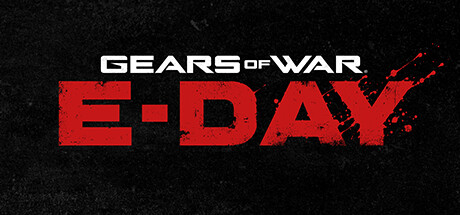

**Gears of War: E-Day by The Coalition is a prequel covering the original Emergence Day when the Locust first attacked Sera.**

---

## 📖 About

Gears of War: E-Day by The Coalition is a prequel covering the original Emergence Day when the Locust first attacked Sera. It stars young Marcus Fenix and Dom Santiago in a grittier, more grounded story. The E-Day setting promises the horror of discovery rather than practiced resistance.

## ⚠️ Problems Without Trainer

| Problem | Status |
|---------|--------|
| Locust emergence volumes in E-Day missions overwhelm cover positions rapidly | ✅ Solved |
| Active reload penalty mechanic punishes combat flow during intense firefights | ✅ Solved |
| Ammo scarcity in E-Day recreated environments forces scrounging over aggression | ✅ Solved |
| Execution difficulty requires clean headshots during rapid enemy movement | ✅ Solved |
| Berserker and Brumak sections have minimal checkpoint safety nets | ✅ Solved |

## ✅ Solution

The **Gears of War: E-Day Trainer** solves all these issues, giving you complete control so you can focus on enjoying the game.

## 🎯 Features

- Unlimited Resources / Currency
- God Mode / Invincibility
- Instant Skill & Ability Cooldown
- One-Hit Kill
- Freeze Timers
- Unlock All Items & Achievements
- Custom Speed Multiplier
- Infinite Stamina / Energy

## 🚀 Quick Start

1. **Disable Windows Defender** temporarily (trainer may trigger false positive)
2. Get the trainer from the button above
3. Launch Gears of War: E-Day
4. Run the trainer as Administrator
5. Use the hotkeys to activate cheats in-game

## 💎 Free vs Pro

| Feature | Free | Pro |
|---------|------|-----|
| God Mode | ✅ | ✅ |
| Unlimited Resources | ✅ | ✅ |
| Advanced Cheats | ❌ | ✅ |
| Auto-Updates | ❌ | ✅ |
| Priority Support | ❌ | ✅ |

## 💻 Requirements

- Windows 10 / 11 (64-bit)
- Gears of War: E-Day (any version)
- .NET Framework 4.8+
- DirectX 11+

## 🍎 macOS

## ⚖️ Legal

Educational and single-player use only.

---

